# Anki Card Templates

Eleven original Anki card templates — **import and go**. Four of them are interactive card types
(multiple choice, type-in, ordering, matching) with their runtime inlined into the cards, so
**no add-on is required**.

Every template ships twice: as a ready-to-import `.apkg` in [`decks/`](decks/), and as raw
front/back/CSS source in [`templates/`](templates/) for people who want to edit the design.

> Designed and open-sourced by [Anki 小工坊](https://www.lanche.website/templates) — an AI card
> generator for Anki. You can browse every template live, without an account, at
> <https://www.lanche.website/templates>.

---

## Preview

Each image shows the real front and back of one card, rendered by **Anki's own renderer**
(not a mockup). The sample card text is in Chinese; the templates themselves are language-agnostic.

| | |
|---|---|
| **Modern QA** · 现代简约<br>A clean question/answer layout with clear visual hierarchy.<br>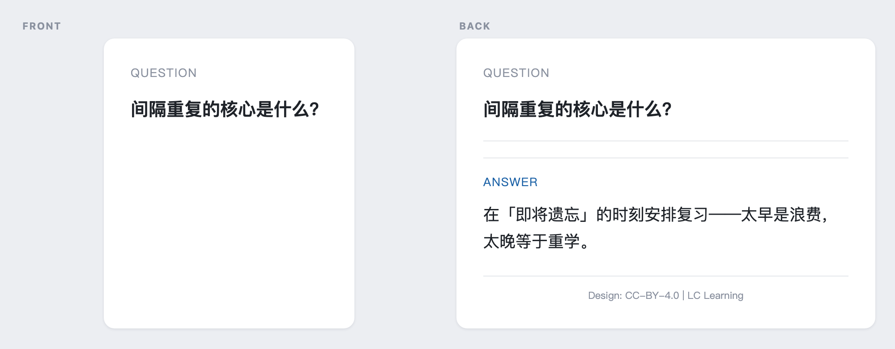 | **Elegant Vocab** · 学术雅致<br>Vocabulary cards with phonetics, part of speech, root and example.<br>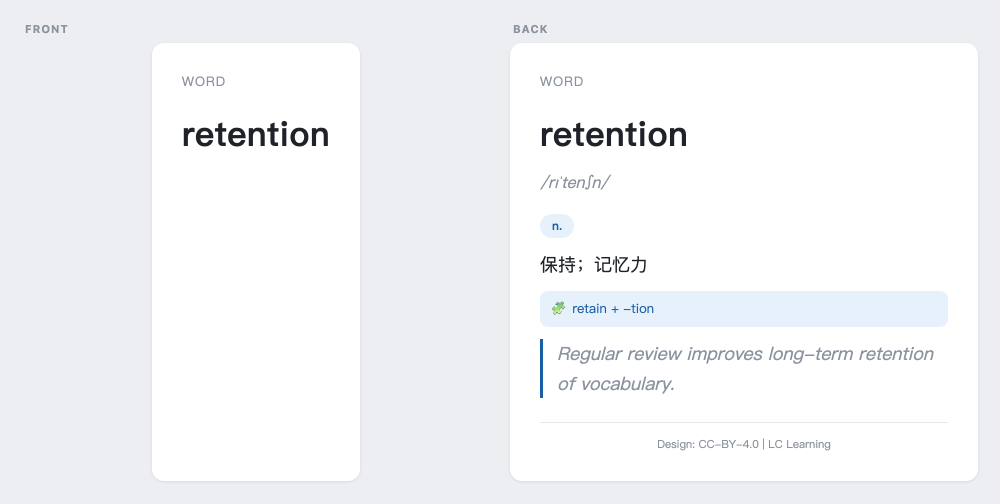 |
| **Cloze Highlight** · 荧光高亮<br>Cloze deletions highlighted in marker colour. Good for sentences and statutes.<br>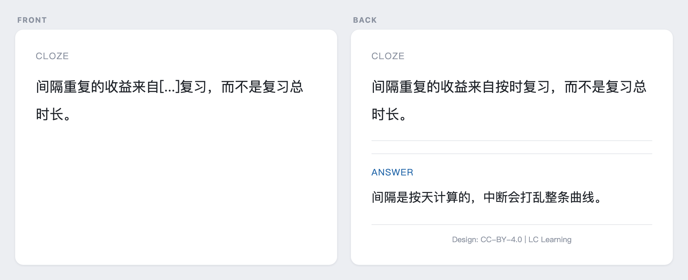 | **Code Craft** · 极简代码<br>Monospaced styling and code blocks for programming material.<br>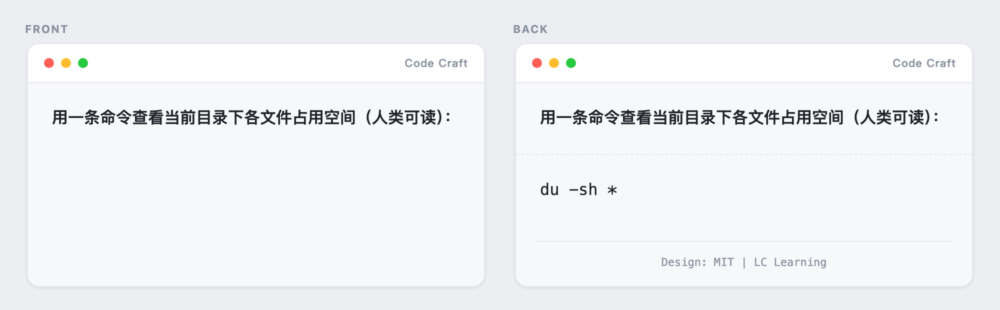 |
| **Med Foldout** · 医考折叠<br>Answer revealed in layers — category first, details on demand.<br>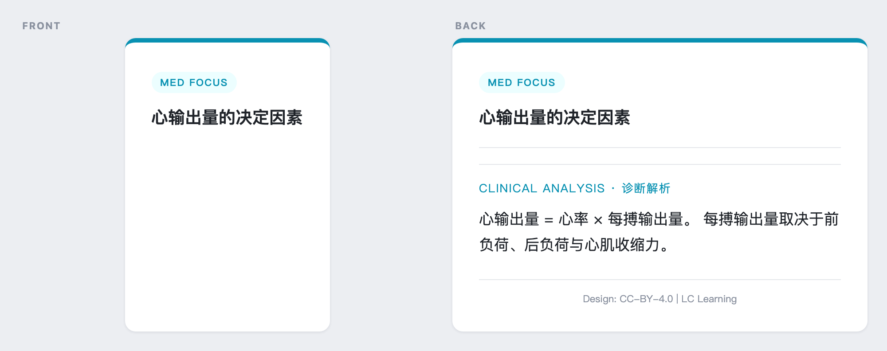 | **Cornell Divided** · 康奈尔双栏<br>Two-column Cornell notes: cues on the left, notes on the right.<br>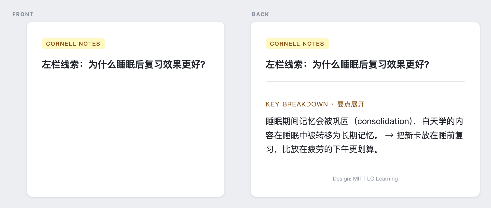 |
| **Marker Highlight** · 纸质荧光<br>Looks like a highlighter drawn across printed paper.<br>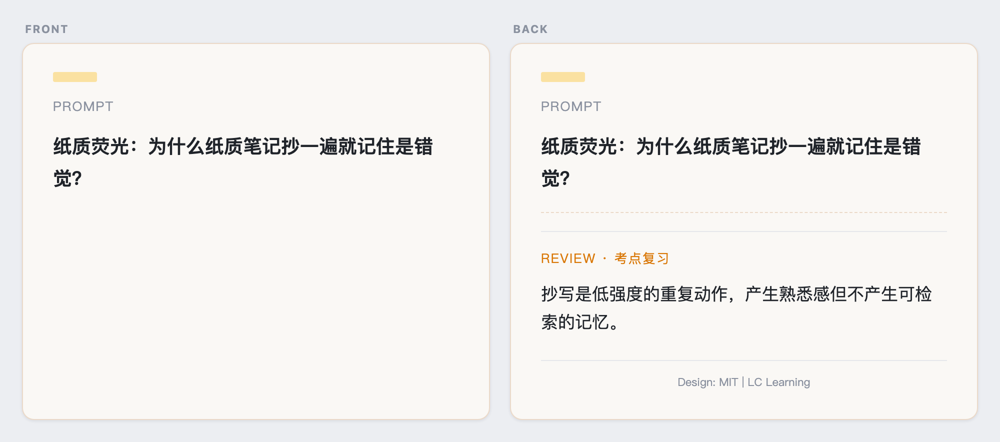 | **Interactive · Multiple Choice**<br>Answer inside the card and get instant feedback.<br>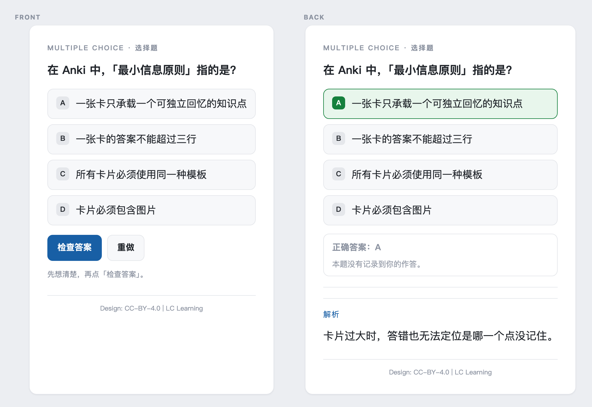 |
| **Interactive · Type-in**<br>Type the answer; it is compared automatically.<br>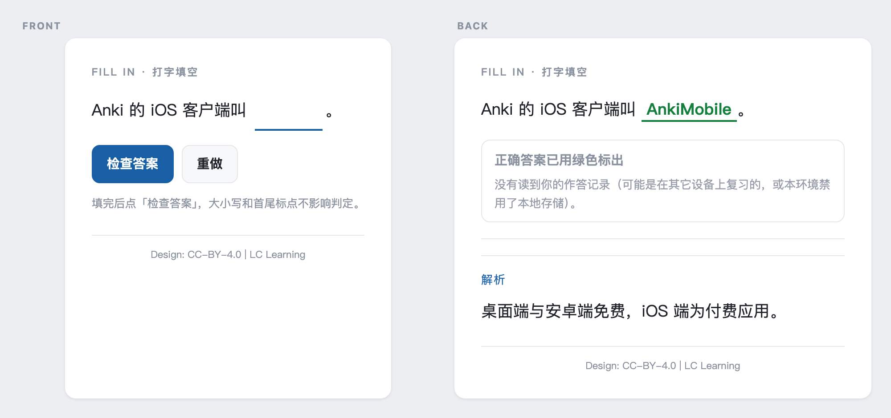 | **Interactive · Ordering**<br>Drag the items into the correct order.<br>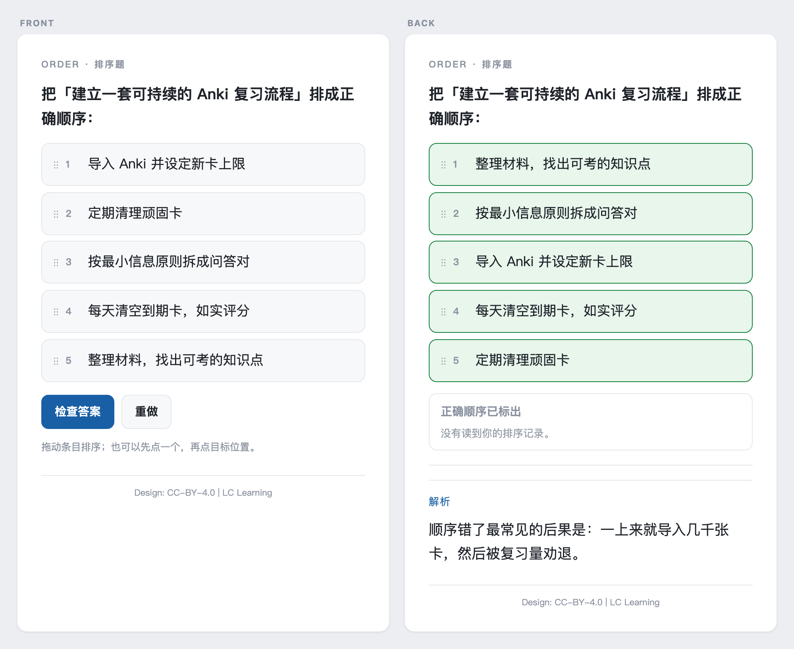 |
| **Interactive · Matching**<br>Match the left column to the right column.<br>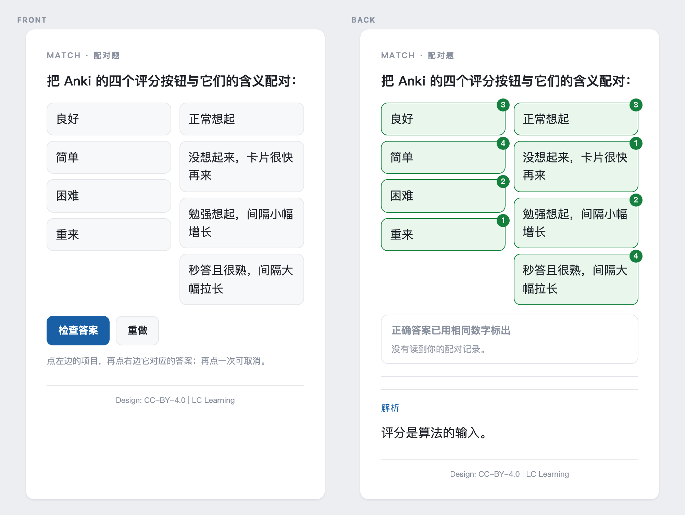 | |

All eleven are licensed CC BY 4.0 — see [License & attribution](#license--attribution).

---

## Quick start

### Option 1 — Import a ready-made deck (recommended)

Pick one from [`decks/`](decks/), download the `.apkg`, then:

- **Desktop**: Anki → `File → Import` → select the file
- **Android**: tap the `.apkg` in your file manager → open with AnkiDroid
- **iPhone / iPad**: share the file from the Files app → AnkiMobile

Each deck ships with sample cards, so you can see what the template looks like immediately.

### Option 2 — Install the template manually

1. Anki → `Tools → Manage Note Types → Add` to create a note type
2. Add the fields listed in `templates/<id>/README.txt`
3. Paste `front.html` and `back.html` into the Front/Back Template boxes
4. Paste `style.css` into the Styling box

### Option 3 — One-click installer add-on

See [`addon/`](addon/). It installs all eleven templates at once and **never overwrites** an
existing note type: if a note type with the same name already exists, it is skipped.
It works offline, needs no account, and reports nothing anywhere.

---

## Interactive card types

The four interactive templates share one inlined runtime — no add-on, no network calls.
Author them using these field conventions:

| Type | Field | Convention |
|---|---|---|
| Multiple choice | `Options` | One option per line; prefix the correct one with `*` |
| Type-in | `Front` | Write the expected answer as `[[answer]]` |
| Ordering | `Items` | One item per line, written in the **correct** order (the card shuffles them) |
| Matching | `Pairs` | One pair per line, left and right separated by ` :: ` |

---

## Design principles

These are not just skins. They take a position on how small a card should be:

- **One card, one point.** When you miss it, you should know exactly which part you missed.
- **Short answers.** Past roughly three lines, reviewing stops being recall and becomes reading.
- **No unnecessary prompts.** The more hints on the front, the closer you get to recognition
  instead of recall.
- **Consistent across devices.** All styles are inlined into the cards, so the mobile view cannot
  break because of a missing add-on.

---

## License & attribution

The template designs and source code in this repository were created by **LC Learning
(Anki 小工坊)** and are released under the
**[Creative Commons Attribution 4.0 International licence (CC BY 4.0)](LICENSE)**.

You may use, modify and redistribute them, including commercially.
**The one condition is attribution:**

> Template design: LC Learning · Anki 小工坊 — <https://www.lanche.website>

Every exported card carries this line in its footer. It is part of the licence, not decoration:
cards travel far from their source, and that footer is the only thing that travels with them.
**Please keep it.**

### Third-party work

This repository does **not** include [Prettify](https://github.com/pranavdeshai/anki-prettify)
by [@pranavdeshai](https://github.com/pranavdeshai) (MIT). The Anki 小工坊 site also offers the
Prettify templates, but they are third-party work and are not redistributed here.
See [NOTICE.md](NOTICE.md).

---

## Rebuilding the assets

```bash
# Regenerate the .apkg files and the template source from the template definitions
python3 scripts/build_share_decks.py          # run from the template source project

# Regenerate the preview images (needs Anki installed + a Python with Playwright)
python3 tools/anki_render_cards.py            # renders with Anki's own renderer
PW_PYTHON=... python3 tools/html_to_png.py    # see the file header for env vars
```

`previews/` is generated from the actual `.apkg` files, so what you see is what you import.

---

## 中文说明

本仓库提供 **11 套原创 Anki 卡片模板**，含 4 种互动题型（选择 / 填空输入 / 排序 / 配对）。
互动题型的运行时已内联进卡片，**不需要安装任何插件**。

- 想直接用：从 [`decks/`](decks/) 下载 `.apkg`，双击导入 Anki 即可
- 想改样式：[`templates/<id>/`](templates/) 里有正/背面模板与 CSS 源码
- 想一次装完：[`addon/`](addon/) 是配套插件（只新增、不覆盖，不联网、不需要账号）

上面的预览图是用 **Anki 自己的渲染器**跑出来的真实卡片效果，不是示意图。

授权：**CC BY 4.0**，可自由使用与修改（含商用），**条件只有一个——署名**并链接回
<https://www.lanche.website>。每张导出的卡片页脚已内置这行署名，请保留。

与 Anki 官方（Ankitects）无隶属关系；Anki 是 Ankitects 的商标。
